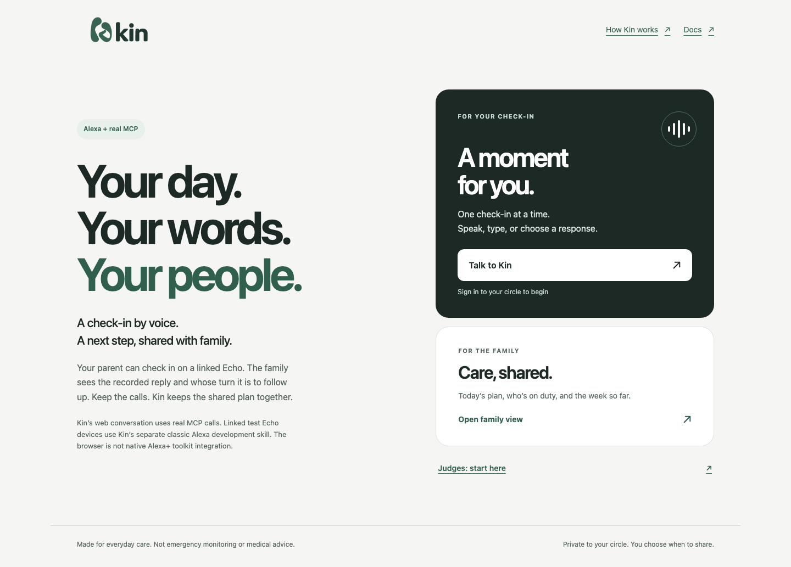

<p align="center">
  
</p>

<h1 align="center">Kin</h1>

<p align="center"><strong>Your day. Your words. Your people.</strong></p>

<p align="center">
  Everyday care, shared across households.<br />
  A parent's voice check-in. A shared family plan. A clearer next turn.
</p>

<p align="center">
  <a href="https://kin.gowthamsarveswaran.com/">Meet Kin</a> ·
  <a href="#try-one-complete-family-care-story">Try the story</a> ·
  <a href="docs/README.md">Documentation</a> ·
  <a href="docs/testing-instructions.md">Try Kin</a>
</p>

Kin helps families keep track of everyday care without making the parent
manage another app. A parent can reply on a linked Echo; their family sees the
recorded reply, today's plan and whose turn it is to follow up in a shared web
workspace.

Keep the calls. Kin keeps the shared plan together.

## Try one complete family-care story

From a checkout of this repository, use **Node 22.23.2** and run:

```sh
npm ci --ignore-scripts --no-audit --fund=false
npm run build
npm run demo:story
```

Open **[127.0.0.1:3030/story.html](http://127.0.0.1:3030/story.html)**.
The terminal should print `Kin local story:`. No Kin account, AWS credentials,
Echo or phone permission is needed for this route.

1. **Reply.** Choose **Not yet**, review the proposed check-in and confirm it.
   The family's view records the reply; the check-in stays incomplete.
2. **Follow up.** Advance the story clock to **9:31 AM**. A follow-up appears
   for Theo after the ordinary 30-minute grace period. Acknowledge it and see
   that acknowledgment does **not** complete Evelyn's check-in.
3. **Catch up.** Draft **Done**, review and confirm it separately. Open the
   weekly brief and inspect the recorded facts behind it.

This isolated story uses **real local MCP calls and shared state**, with
synthetic people, history, time and notifications. It does not connect to an
Echo or send a phone alert. The default launch makes no AWS or model calls;
optional dictation may use the browser's speech provider. Keep it on loopback,
and restart the process to reset the story.

[Detailed walkthrough and optional Nova mode →](docs/story-demo.md)

## A moment for you. A shared view for your family.



*The actual Kin homepage, captured locally. This image contains no family records.*

The person checking in can use a linked Echo or Kin's web conversation.
Caregivers use the responsive web workspace on a phone or computer; it can also
be added to a phone's home screen. There is no separate app-store download.

| In Kin | What it helps you do |
| --- | --- |
| **Today** | See recorded replies, the current caregiver assignment and unresolved family follow-ups. |
| **Plan** | Arrange routines and review changes to individual check-ins. |
| **Turns** | Agree who is on duty, review handoffs and propose coverage for uncovered days. |
| **Week** | Catch up through evidence-linked notes and printable visit notes. |
| **Ask Kin** | Speak, type or choose a reply, then review it before saving through MCP. |

Invitations and access controls keep the workspace limited to accepted circle
members. A name on the roster is not an account or an invitation.

## A follow-up is not a verdict

**Not yet** is a useful reply, not a failure. It keeps the check-in incomplete
and gives the family a clearer starting point for a conversation. When automatic
processing is enabled and routing is ready, an overdue check-in can prompt a
discreet follow-up to the caregiver assigned for that day.

Acknowledging that follow-up means **seen**—not contacted, completed or safe.
The parent's reply and the caregiver's acknowledgment remain separate records.
Assigned days describe coverage, not a measurement of caregiving effort.

Weekly notes stay tied to recorded activity. Optional Amazon Bedrock selection
is checked against source evidence; an evidence-linked deterministic brief is
available when the model is unavailable or its output is rejected. Neither path
provides a health assessment.

## Real voice. Real MCP. One shared plan.

Kin's portable core is a self-hosted **Model Context Protocol (MCP)** server,
compatible with protocol **2025-11-25**, using Streamable HTTP and an MCP Apps
widget. It exposes tools for reading the plan, recording reviewed replies and
reading the weekly brief. Authorized optional tools support undo, plan
cancellation and reminder preparation.

| Connection | How it works |
| --- | --- |
| **Linked Echo Pop** | A classic Alexa development skill calls Kin's MCP server through the linked family account. The tested invocation is “Alexa, open kin family.” |
| **Kin web conversation** | Kin's own interface calls the MCP server; it is not Amazon's Alexa+ interface. |
| **Standard MCP clients** | OAuth sign-in, resource-bound permissions and current family membership protect access. See the [interoperability guide](docs/mcp-interoperability.md). |

The working Echo connection is a classic Alexa development skill. It is
separate from native Alexa+ Toolkit access and is not a published Skills Store
listing.

## Built around consent and clear boundaries

- **Review before a care change.** Interpreting a reply proposes an action;
  it does not silently save one. Changed task state invalidates the review.
- **Safe retries.** The same confirmation request reuses its receipt instead
  of recording the reply twice.
- **Private family access.** Sign-in and current membership are checked on
  the server. Linked-account attribution does not identify the physical speaker.
- **Optional reminders and notifications.** An assignment is not notification
  consent. Reminder cancellation can be delayed or fail; phone delivery is
  best-effort, not an emergency service.
- **Evidence over inference.** A missing reply, an empty plan or an acknowledged
  follow-up never establishes that somebody is safe.

Kin coordinates ordinary family care. It is **not** a medical device,
medication adviser, fall detector, emergency monitor or replacement for a call.

## Explore the documentation

**[Kin Docs](https://gowtham0992.github.io/kin/)** covers the product, family
workspace, Echo connection and privacy boundaries. Hosted docs are currently
offline while the repository is private; read the
[curated guides in this repository](docs-site/content/intro.mdx) meanwhile.
The [repository documentation hub](docs/README.md) brings the product and
developer guides together:

- [Try Kin](docs/testing-instructions.md) without family credentials.
- [Run and configure Kin](docs/development.md) for local development.
- [Understand the architecture](docs/architecture.md) and its design decisions.
- [Connect a standard MCP client](docs/mcp-interoperability.md).

For developers, `npm run check` runs the build and test suite. Browser journeys
have their own [verification instructions](docs/development.md#verify-changes).
Cloud deployment, paid models and delivery operations are separate, explicitly
configured workflows—not part of the quickstart.

## Current availability

The [public site](https://kin.gowthamsarveswaran.com/) explains Kin; the hosted
family workspace requires authorized sign-in and membership. The repository is
MIT licensed; source access follows the repository's visibility. The local
story is the credential-free review route from a checkout; source access does
not grant live family membership.

General recurring missed-check-in processing is currently **off**. Reminder
reconciliation is on; cancellation can still be delayed or fail. Phone alerts
require explicit setup, consent and active routing. They are best-effort, not an
always-on delivery promise, and Kin does not claim verified SMS delivery.

The documentation site uses GitHub Pages and is currently offline while the
repository is private. The product and developer guides remain available in
this repository.

## License

[MIT](LICENSE) · Copyright © 2026 **Gowtham Sarveswaran**.
